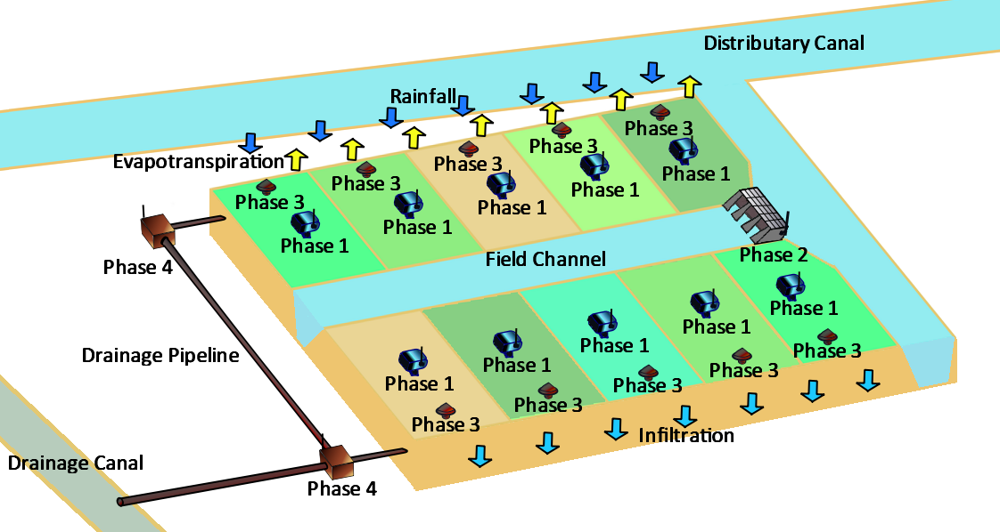
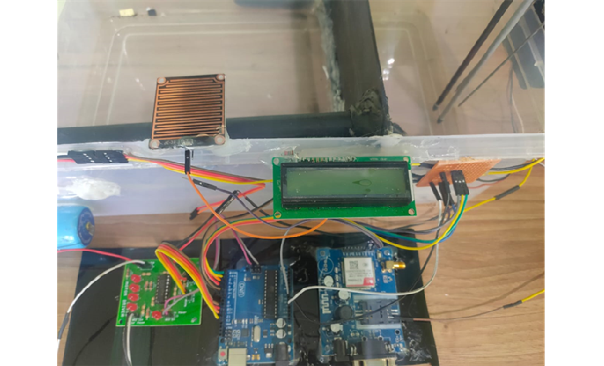
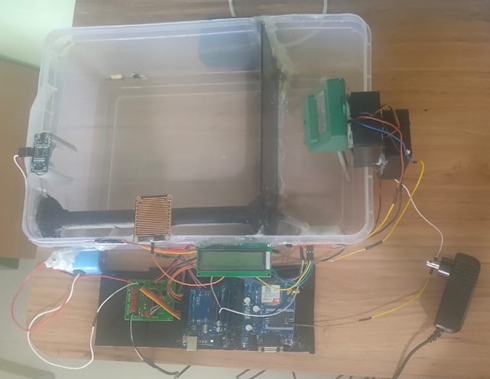

# AutoFarm Water Regulator

An Arduino based agricultural water management project designed to monitor field conditions and regulate water inflow and drainage, primarily for paddy fields.

## Project Overview

AutoFarm Water Regulator was developed as an academic engineering project in 2020. The system was designed to improve irrigation water management by monitoring water levels and selected water quality parameters, controlling water supply and drainage, and sending alerts to farmers through a GSM module.

The project combines an Arduino based control system with a proposed automatic mini barrage and drainage arrangement.

## Objectives

- Monitor water levels in agricultural fields.
- Control irrigation water supply and excess drainage.
- Monitor water pH and salinity.
- Detect rainfall and respond to changing field conditions.
- Send alerts to farmers through GSM communication.
- Reduce unnecessary water usage and the risk of field flooding.

## Hardware Components

The project design includes the following components:

| Component | Quantity |
|---|---:|
| Arduino UNO | 1 |
| Ultrasonic sensor | 1 |
| pH sensor | 1 |
| Water-quality sensor | 1 |
| Rain sensor | 1 |
| GSM module | 1 |
| LCD display | 1 |
| DC water pumps | 2 |

## Working Principle

The Arduino UNO receives sensor inputs and controls the water supply and drainage operations according to predefined conditions.

- **Low water level:** Water quality parameters are checked before allowing water into the field.
- **High water level:** The barrage is closed and the drainage system is activated.
- **Rain detection:** The system responds by controlling the barrage and drainage and sending an alert.
- **Water-quality abnormality:** The water supply is restricted and an alert is sent to the farmer.

Sensor readings and system status can be displayed on the LCD. GSM communication is intended to provide SMS alerts.

## Four-Phase System Architecture

The proposed agricultural water management system is divided into four phases.

### Phase 1 – Water Level Indication

Monitors field water conditions using a sensor based arrangement. The proposed design includes a microcontroller and GSM communication to inform the farmer about field conditions.

### Phase 2 – Field Water Controller

Controls irrigation water entering the field through an automatic mini barrage. The proposed arrangement also includes water quality monitoring and a wire mesh to prevent snails and solid waste from entering the field.

### Phase 3 – Excess Water Drain

Collects excess water from the agricultural field during heavy rainfall or other conditions that cause water accumulation.

### Phase 4 – Drainage Water Controller

Controls the discharge of excess water from the field to help prevent flooding.

*Note: The four phase diagram represents the proposed overall system architecture. It does not mean that every feature shown was implemented in the physical prototype.*

## Project Gallery

### Physical Prototype

Close-up view of the electronic components:

Overall view of the developed prototype:

## Proteus Simulation

The project was also simulated using Proteus to test the circuit and Arduino control logic.

The Proteus simulation uses an analog potentiometer connected to A2 to represent changes in water level. In the physical prototype, an ultrasonic sensor was used for water level measurement.

The simulation files, Arduino source code and circuit screenshot are available in the repository.

## Repository Contents

| Folder/File | Description |
|---|---|
| `images/` | Physical prototype photographs and four-phase system diagram |
| `code/` | Arduino source code used for the Proteus simulation and code documentation |
| `simulation/` | Proteus project and related simulation files |

## Limitations

- The physical prototype was developed, but the original hardware source code and working demonstration video are not currently available.
- The Arduino source code included in this repository is for the Proteus simulation; it should not be assumed to be the original physical prototype code.
- Sensor readings require calibration for reliable field measurements.
- Toxicity monitoring was part of the proposed design but was not completed.
- The control system uses predefined conditions and does not implement crop stage specific water management.

## Future Scope

- Improve sensor calibration and reliability.
- Integrate more accurate water quality monitoring.
- Develop crop stage based water management.
- Improve remote monitoring and communication.
- Extend testing under actual agricultural field conditions.

## Project Information

**Project:** AutoFarm Water Regulator  
**Year:** 2020  
**Controller:** Arduino UNO  
**Application:** Agricultural irrigation and water management  
**Simulation Software:** Proteus 8 Professional
